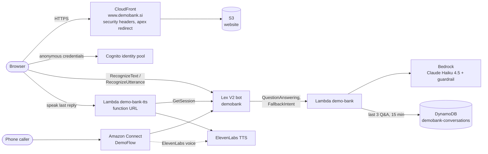

# DemoBank virtual assistant

**Live: [www.demobank.si](https://www.demobank.si/)**

A text and voice assistant for a fictional bank's high yield savings account. Visitors can chat or talk with it on the website, or call it on the phone. Answers come from Amazon Bedrock (Claude Haiku 4.5) with a guardrail, routed through an Amazon Lex V2 bot. On the phone, Amazon Connect speaks with an ElevenLabs voice.

This repo holds everything that's deployed: the website, both Lambda functions, the Lex bot, the Connect flow, and the AWS configuration they depend on.

## Architecture



## Repository Layout

| Path | Deployed as | Contents |
| --- | --- | --- |
| [`website/`](website) | S3 bucket `demobank-virtual-assistant`, CloudFront `EKNGTSQVBSF70` | `index.html` (markup and CSS), `app.js` (page script), `lex-sdk.min.js` (built from `sdk/`), `voicebot.vtt` (captions; the video itself, `voicebot.mp4`, is only kept in the bucket), `preview.png`, `favicon.png` |
| [`website/sdk/`](website/sdk) | — | Builds `lex-sdk.min.js`: AWS SDK v3 Lex runtime plus anonymous Cognito credentials |
| [`lambda/demo-bank/`](lambda/demo-bank) | Lambda `demo-bank` | Answers `QuestionAnswering` and `FallbackIntent` with Bedrock, with input limits, the guardrail, and conversation memory in DynamoDB. [`config.json`](lambda/demo-bank/config.json) has the runtime settings and environment. |
| [`lambda/demo-bank-tts/`](lambda/demo-bank-tts) | Lambda `demo-bank-tts` (public function URL) | Speaks the bot's last reply on the website with the same ElevenLabs voice as the phone line |
| [`lex/`](lex) | Lex V2 bot `BWKAOWFRLW`, version 51, alias `GFO9LFVAOZ` | Bot export (LexJson): Welcome, QuestionAnswering, WhoAreYou, TransferToAgent, Goodbye, and Fallback intents |
| [`connect/DemoFlow.json`](connect/DemoFlow.json) | Amazon Connect contact flow `DemoFlow` | Greeting, ElevenLabs voice, Lex bot, and transfer to an agent queue |
| [`aws/`](aws) | — | Configuration for reference and rebuilds: the Bedrock guardrail (version 11), the CloudFront function and security headers policy (CSP, HSTS), IAM policies, and the DynamoDB table |

Secrets aren't in the repo. The ElevenLabs API key is in the Secrets Manager secret `Eleven_Labs`; the flow and `demo-bank-tts` only reference it.

## Deploy

All resources are in AWS account 819097794827, region `us-west-2`. In Git Bash, set `MSYS_NO_PATHCONV=1`, or the CloudFront invalidation path gets mangled.

**Website.** Upload only the site files, each with its content type (the security headers include `X-Content-Type-Options: nosniff`), then invalidate:

```shell
cd website
aws s3api put-object --bucket demobank-virtual-assistant --key app.js --body app.js --content-type text/javascript
aws s3api put-object --bucket demobank-virtual-assistant --key lex-sdk.min.js --body lex-sdk.min.js --content-type text/javascript
aws s3api put-object --bucket demobank-virtual-assistant --key index.html --body index.html --content-type text/html
MSYS_NO_PATHCONV=1 aws cloudfront create-invalidation --distribution-id EKNGTSQVBSF70 --paths "/*"
```

When `app.js` or `lex-sdk.min.js` changes, bump the `?v=` value on its script tag in `index.html`. The CSP in [`aws/cloudfront/demobank-security-headers.json`](aws/cloudfront/demobank-security-headers.json) lists every host the page talks to, and it forbids inline scripts.

**SDK bundle:**

```shell
cd website/sdk
npm ci
npm run build    # writes ../lex-sdk.min.js
```

**Lambda functions.** The zip must contain `index.mjs` at its root:

```shell
cd lambda/demo-bank && zip ../demo-bank.zip index.mjs && cd ..
aws lambda update-function-code --function-name demo-bank --zip-file fileb://demo-bank.zip
```

**Lex bot.** Zip the contents of [`lex/`](lex) (with `Manifest.json` at the root) and import it in the Lex console or with `aws lexv2-models start-import`. Then build the locale, create a bot version, and point alias `GFO9LFVAOZ` at it.

**Connect flow.** In the Connect admin site, open `DemoFlow` and import [`connect/DemoFlow.json`](connect/DemoFlow.json), or use `aws connect update-contact-flow-content`.

## Notes

- `demo-bank` refuses questions with more than 20 words, a word over 20 characters, more than 200 characters, or unusual characters. `app.js` mirrors these limits; change both together.
- Conversation memory is kept in DynamoDB rather than Lex session attributes, because Amazon Connect replaces those on every turn, which would break follow-up questions on the phone.
- `demo-bank-tts` has a reserved concurrency of 2 because the ElevenLabs plan allows 3 concurrent requests and the phone line shares them.
- [`AGENTS.md`](AGENTS.md) has operational details for maintainers: rollback, testing the phone path without calling, and guardrail troubleshooting.

## License

[Apache-2.0](LICENSE)
